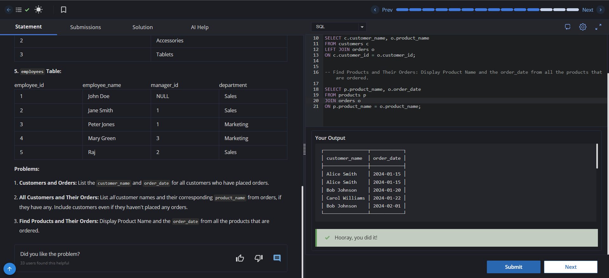

# Experiment 4 - Task 1

Name: GURKIRAT SINGH

UID: 24BCS10337

## Aim

To retrieve customer orders using INNER JOIN, list all customers with their orders using LEFT JOIN, and display ordered products with their order dates.

## Question

Write queries to perform the following:

1. Display the `customer_name` and `order_date` for all customers who have placed orders.
2. Display all customer names and their corresponding `product_name` from orders, if they have any. Include customers even if they have not placed any orders.
3. Display the `product_name` and `order_date` for all products that have been ordered.

## SQL Queries Used

### Customers with Orders

```sql
SELECT c.customer_name, o.order_date
FROM customers c
JOIN orders o
ON c.customer_id = o.customer_id;
```

### All Customers and Their Orders

```sql
SELECT c.customer_name, o.product_name
FROM customers c
LEFT JOIN orders o
ON c.customer_id = o.customer_id;
```

### Products and Their Orders

```sql
SELECT p.product_name, o.order_date
FROM products p
JOIN orders o
ON p.product_name = o.product_name;
```

## Output

```text
The first query returns only customers who have placed orders along with their order dates.
The second query returns every customer and shows the product name when an order exists; otherwise, the order fields remain NULL.
The third query returns the products that were ordered along with the corresponding order dates.
```

## Output Screenshot



## Image Explanation

The queries demonstrate how JOIN and LEFT JOIN work across the `customers`, `orders`, and `products` tables. The INNER JOIN statements return only matching rows, while the LEFT JOIN keeps all customers even when they do not have matching orders.

## Result

The required joins were performed successfully, and the customer and product order details were retrieved as expected.
