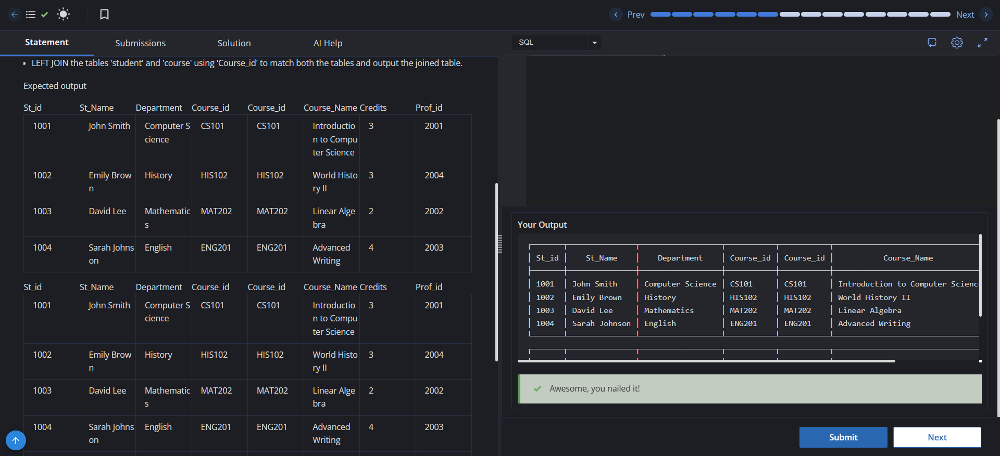

# Experiment 4 - Task 2

Name: GURKIRAT SINGH

UID: 24BCS10337

## Aim

To join the `student` and `course` tables using INNER JOIN and LEFT JOIN on `Course_id`.

## Question

Write queries to do the following:

1. Join the tables `student` and `course` using `Course_id` and output the joined table.
2. Left join the tables `student` and `course` using `Course_id` and output the joined table.

## SQL Queries Used

### Inner Join student and course

```sql
SELECT *
FROM student s
JOIN course c
ON s.Course_id = c.Course_id;
```

### Left Join student and course

```sql
SELECT *
FROM student s
LEFT JOIN course c
ON s.Course_id = c.Course_id;
```

## Output

```text
The INNER JOIN returns only the records where student and course have matching Course_id values.
The LEFT JOIN returns all rows from student and matching rows from course; unmatched course details appear as NULL.
```

## Output Screenshot



## Image Explanation

The queries show the difference between INNER JOIN and LEFT JOIN on the `Course_id` column. INNER JOIN keeps only matched rows, while LEFT JOIN preserves every student row even if the matching course record is missing.

## Result

The student and course tables were joined successfully using both INNER JOIN and LEFT JOIN, producing the expected results.