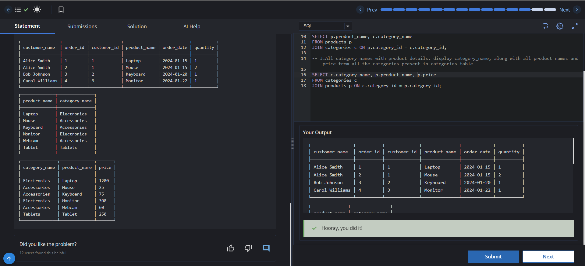

# Experiment 4 - Task 3

Name: GURKIRAT SINGH

UID: 24BCS10337

## Aim

To retrieve order details with customer information and display product-category combinations using INNER JOIN.

## Question

Write queries to do the following:

1. Get all orders along with the details of their respective customers if they exist.
2. Display product names and category names where the product and category tables have matching `category_id` values.
3. Display `category_name`, `product_name`, and `price` for all matching records from the `categories` and `products` tables.

## SQL Queries Used

### Orders with Customer Details

```sql
SELECT c.customer_name, o.order_id, o.customer_id, o.product_name, o.order_date, o.quantity
FROM Customers c
JOIN Orders o
ON c.customer_id = o.customer_id;
```

### Products and Categories

```sql
SELECT p.product_name, c.category_name
FROM products p
JOIN categories c ON p.category_id = c.category_id;
```

### Categories with Product Details

```sql
SELECT c.category_name, p.product_name, p.price
FROM categories c
JOIN products p ON c.category_id = p.category_id;
```

## Output

```text
The first query returns each order together with the matching customer details.
The second query returns product and category pairs only when their category IDs match.
The third query returns the category name, product name, and price for records that match across the categories and products tables.
```

## Output Screenshot



## Image Explanation

The screenshot shows the SQL queries executed for Task 3. The results demonstrate how JOIN works between the Customers, Orders, Products, and Categories tables by returning only rows with matching key values.

## Result

The required joins were performed successfully, and the customer, product, and category details were retrieved as expected.