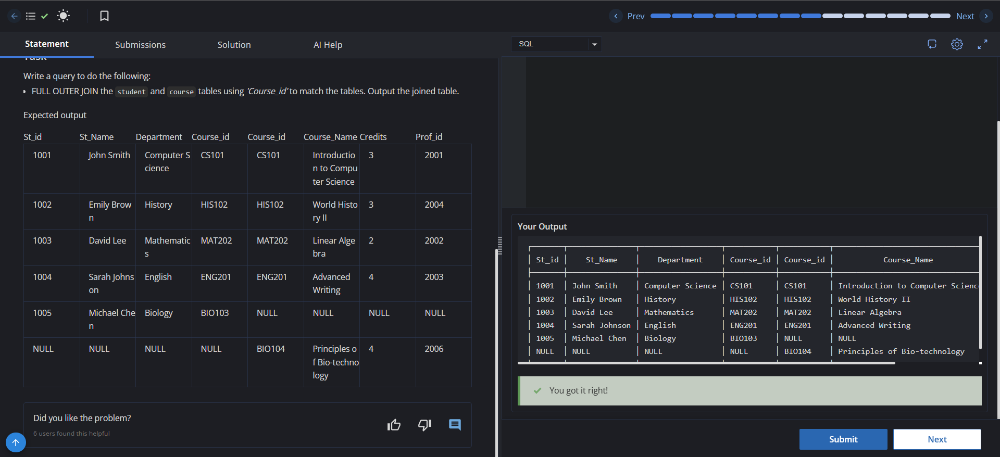

# Experiment 4 - Task 4

Name: GURKIRAT SINGH

UID: 24BCS10337

## Aim

To combine the `student` and `course` tables using FULL OUTER JOIN on `Course_id`.

## Question

Write a query to FULL OUTER JOIN the `student` and `course` tables using `Course_id` and output the joined table.

## SQL Queries Used

### Full Outer Join student and course

```sql
SELECT *
FROM student s
FULL OUTER JOIN course c
ON s.Course_id = c.Course_id;
```

## Output

```text
The FULL OUTER JOIN returns all rows from both student and course tables.
Matched rows are combined into one record, while unmatched rows from either table appear with NULL values in the missing columns.
```

## Output Screenshot



## Image Explanation

The screenshot shows the FULL OUTER JOIN query executed on the `student` and `course` tables. The result includes matched rows as well as rows that do not have a matching `Course_id` in the other table.

## Result

The student and course tables were combined successfully using FULL OUTER JOIN, and the expected joined output was produced.