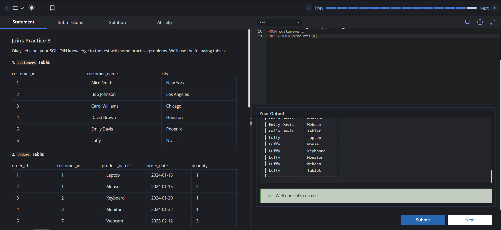

# Experiment 4 - Task 5

Name: GURKIRAT SINGH

UID: 24BCS10337

## Aim

To display employee-manager pairs using a self join and generate every possible customer-product combination using a cross join.

## Question

Write queries to do the following:

1. Display a list of employee names along with their manager's names using the `employees` table.
2. Show every possible combination of `customer_name` from the `customers` table and `product_name` from the `products` table.

## SQL Queries Used

### Employee and Manager Names

```sql
SELECT e.employee_name AS employee, e2.employee_name AS manager
FROM employees e
LEFT JOIN employees e2
ON e.manager_id = e2.employee_id;
```

### Every Possible Combination

```sql
SELECT c.customer_name, p.product_name
FROM customers c
CROSS JOIN products p;
```

## Output

```text
The first query returns each employee with the name of their manager when one exists.
The second query returns every possible pairing of customers and products.
```

## Output Screenshot



## Image Explanation

The screenshot shows the self join on the `employees` table and the cross join between `customers` and `products`. The self join matches each employee with their manager, while the cross join combines every row from the first table with every row from the second table.

## Result

The employee-manager mapping and all possible customer-product combinations were retrieved successfully.
