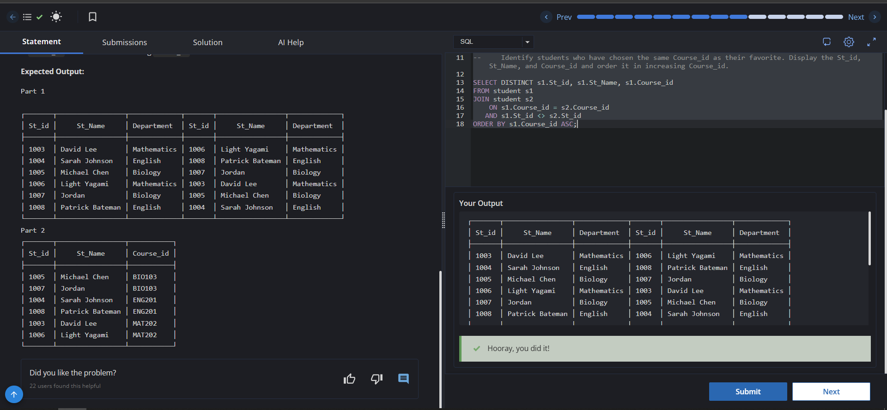

# Experiment 4 - Task 6

Name: GURKIRAT SINGH

UID: 24BCS10337

## Aim

To use SELF JOIN on the `student` table to find students from the same department and students who share the same favorite `Course_id`.

## Question

Write queries to do the following:

1. Find pairs of students that belong to the same department.
2. Identify students who have chosen the same `Course_id` as their favorite and display `St_id`, `St_Name`, and `Course_id` in increasing order of `Course_id`.

## SQL Queries Used

### Students from the Same Department

```sql
SELECT s1.st_id, s1.st_name, s1.department, s2.st_id, s2.st_name, s2.department
FROM student s1
JOIN student s2
ON s1.department = s2.department
AND s1.St_id <> s2.St_id;
```

### Students with the Same Favorite Course

```sql
SELECT DISTINCT s1.St_id, s1.St_Name, s1.Course_id
FROM student s1
JOIN student s2
ON s1.Course_id = s2.Course_id
AND s1.St_id <> s2.St_id
ORDER BY s1.Course_id ASC;
```

## Output

```text
The first query returns pairs of students who belong to the same department.
The second query returns students who share the same favorite Course_id, sorted by Course_id in ascending order.
```

## Output Screenshot



## Image Explanation

The screenshot shows the SELF JOIN queries executed on the `student` table. The first query matches students from the same department, while the second query matches students who selected the same favorite course.

## Result

The required self join queries were performed successfully, and the matching student pairs were retrieved as expected.