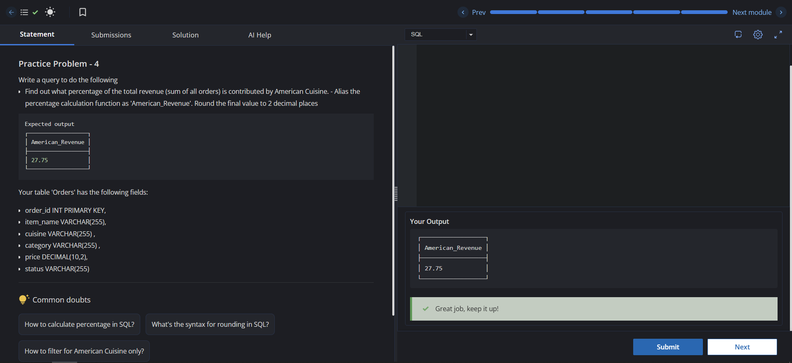

# Experiment 5

Name: GURKIRAT SINGH

UID: 24BCS10337

## Aim

To find the percentage of total revenue contributed by American cuisine using conditional aggregation and rounding.

## Question

Write a query to find out what percentage of the total revenue (sum of all orders) is contributed by American cuisine. Round the final value to 2 decimal places.

The `Orders` table columns:

- `cuisine`
- `price`

## SQL Queries Used

### Percentage of Revenue from American Cuisine

```sql
SELECT ROUND((SUM(CASE WHEN cuisine = 'American' THEN price ELSE 0 END) * 100.0) / SUM(price), 2) AS American_Revenue
FROM Orders;
```

## Output

```text
American_Revenue
----------------
<percentage value>
```

## Output Screenshot



## Image Explanation

The query calculates the total price of orders where `cuisine` is `American`, divides it by the total revenue of all orders, and multiplies by 100 to get the percentage. The `ROUND(..., 2)` function formats the result to two decimal places.

## Result

The SQL query successfully calculates the share of total revenue contributed by American cuisine and returns it rounded to two decimal places.