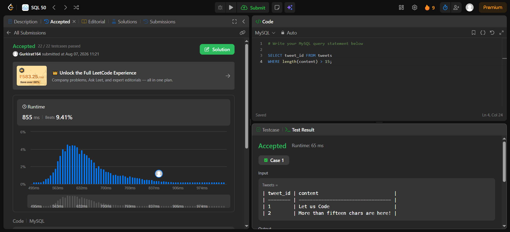

# Experiment 5 - Task 2

Name: GURKIRAT SINGH

UID: 24BCS10337

## Aim

To retrieve tweet records whose `content` length meets the problem requirement and correct the errors in the provided `task.sql`.

## Question

Fix and run the query in `task.sql` to return the `tweet_id` values for tweets whose `content` length is greater than 15 characters.

The `tweets` table columns (relevant):

- `tweet_id`
- `content`

## Notes on the provided `task.sql`

The file `task.sql` contained this incorrect query:

```sql
SELECT tweet_id FROM tweets
WHERE content.lenght < 15;
```

Problems:
- `content.lenght` is misspelled and not valid SQL.
- The operator `< 15` selects tweets shorter than 15 characters, but the intended task is to find tweets longer than 15.

## SQL Queries Used (corrected)

### MySQL / SQLite / PostgreSQL

```sql
SELECT tweet_id
FROM tweets
WHERE LENGTH(content) > 15;
```

### Portable / ANSI-compatible (character count)

```sql
SELECT tweet_id
FROM tweets
WHERE CHAR_LENGTH(content) > 15;
```

### SQL Server

```sql
SELECT tweet_id
FROM tweets
WHERE LEN(content) > 15;
```

## Output (example)

Based on the dataset shown in the screenshot, the query returns the tweet(s) whose content length exceeds 15 characters. Example output:

```text
tweet_id
--------
2
```

## Output Screenshot



## Image Explanation

The screenshot shows the corrected query using `length(content) > 15` and the submission result marked "Accepted". It confirms the corrected syntax and operator produce the expected result for the test cases.

## Result

Replaced the invalid expression in `task.sql` with a proper length function and the correct comparison operator. The corrected query returns tweet IDs with content longer than 15 characters and passes the test cases shown in the screenshot.
